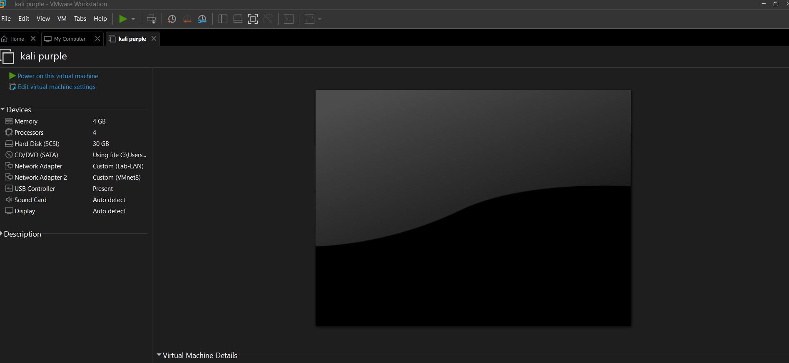
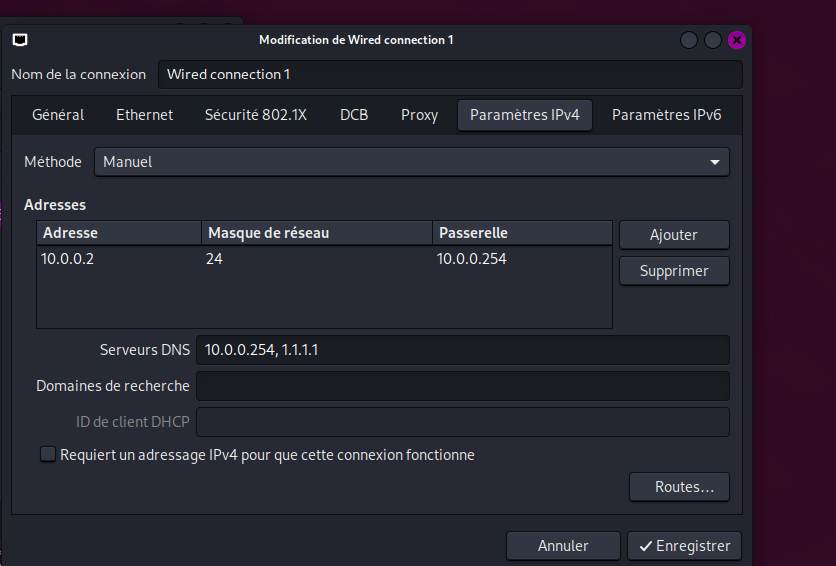

# NETWORKWALKS--BJMIKIA-B084-WK1-PM1-CYBERSECURITY-LAB-SETUP
 # Kali Purple on VMware – NAT network 10.0.0.0/24

🇬🇧 [English](#english) | 🇫🇷 [Français](#français)

---

## English

### Context

The original exercise asked for a Kali Linux VM on VirtualBox. I already had VMware Workstation with Kali Purple installed, so I used that instead and focused on the network part: a custom NAT network `10.0.0.0/24`, with the Kali VM set to the static IP `10.0.0.2/24`.

### Setup

| Item | Value |
|---|---|
| Hypervisor | VMware Workstation |
| Guest OS | Kali Linux Purple |
| Network mode | NAT (VMnet8) |
| Subnet | 10.0.0.0/24 |
| Host adapter (VMnet8) | 10.0.0.1 |
| NAT gateway | 10.0.0.254 |
| Kali IP | 10.0.0.2/24 |

### Screenshots

**VMware home with the VM configuration**


**Kali Purple desktop after boot**


**Network configuration inside Kali**


### Steps

1. In the Virtual Network Editor, set VMnet8 (NAT) to `10.0.0.0` / `255.255.255.0`.
2. Move the NAT gateway to `10.0.0.254` (in `vmnetnat.conf` and `vmnetdhcp.conf`).
3. Set the VM network adapter to NAT.
4. Configure the static IP in Kali:

```bash
sudo nmcli con mod "Wired connection 1" ipv4.method manual \
  ipv4.addresses 10.0.0.2/24 ipv4.gateway 10.0.0.254 \
  ipv4.dns "10.0.0.254,1.1.1.1"
sudo nmcli con up "Wired connection 1"
```

5. Check:

```bash
ip a
ip route
ping -c 2 10.0.0.254
ping -c 2 1.1.1.1
```

### Difficulties encountered

- **IP conflict:** VMware gives the NAT router the `.2` address by default, which is the IP I wanted for Kali. The gateway had to be moved to another address (`10.0.0.254`).
- **Gateway IP greyed out:** in the Virtual Network Editor, the field was not editable. I had to edit `vmnetnat.conf` and `vmnetdhcp.conf` manually in `C:\ProgramData\VMware\`.
- **Order of operations:** the Virtual Network Editor rewrites those config files on every Apply. The subnet must be set first, then the services stopped, then the files edited.
- **Services:** `VMware NAT Service` and `VMnetDHCP` have to be stopped before editing and restarted after.
- **Permissions:** VMware and the text editor must run as administrator, otherwise the changes are not saved.

### Backup

Config files saved in `C:\Backup\vmware-net\` and a VM snapshot taken once the network was working, in case a VMware update overwrites the configuration.

### What I learned

- How VMware NAT works (VMnet8, host adapter, NAT service, DHCP service).
- Setting a static IP with NetworkManager (`nmcli`).
- Basic network troubleshooting (`ip a`, `ip route`, `ping`).

---

## Français

### Contexte

L'exercice de base demandait une VM Kali Linux sous VirtualBox. J'avais déjà VMware Workstation avec Kali Purple installé, donc j'ai utilisé cet environnement et je me suis concentrée sur la partie réseau : un réseau NAT personnalisé `10.0.0.0/24`, avec la VM Kali en IP statique `10.0.0.2/24`.

### Configuration

| Élément | Valeur |
|---|---|
| Hyperviseur | VMware Workstation |
| OS invité | Kali Linux Purple |
| Mode réseau | NAT (VMnet8) |
| Sous-réseau | 10.0.0.0/24 |
| Carte hôte (VMnet8) | 10.0.0.1 |
| Passerelle NAT | 10.0.0.254 |
| IP de Kali | 10.0.0.2/24 |

### Captures d'écran

**Accueil VMware avec la configuration de la VM**


**Bureau de Kali Purple après démarrage**


**Configuration réseau dans Kali**


### Étapes

1. Dans le Virtual Network Editor, régler VMnet8 (NAT) sur `10.0.0.0` / `255.255.255.0`.
2. Déplacer la passerelle NAT sur `10.0.0.254` (dans `vmnetnat.conf` et `vmnetdhcp.conf`).
3. Mettre l'adaptateur réseau de la VM en NAT.
4. Configurer l'IP statique dans Kali :

```bash
sudo nmcli con mod "Wired connection 1" ipv4.method manual \
  ipv4.addresses 10.0.0.2/24 ipv4.gateway 10.0.0.254 \
  ipv4.dns "10.0.0.254,1.1.1.1"
sudo nmcli con up "Wired connection 1"
```

5. Vérifier :

```bash
ip a
ip route
ping -c 2 10.0.0.254
ping -c 2 1.1.1.1
```

### Difficultés rencontrées

- **Conflit d'IP :** VMware attribue par défaut l'adresse `.2` au routeur NAT, c'est justement l'IP que je voulais pour Kali. Il a fallu déplacer la passerelle (`10.0.0.254`).
- **Champ Gateway IP grisé :** dans le Virtual Network Editor, le champ n'était pas modifiable. J'ai dû éditer à la main `vmnetnat.conf` et `vmnetdhcp.conf` dans `C:\ProgramData\VMware\`.
- **Ordre des opérations :** l'éditeur réécrit ces fichiers à chaque Apply. Il faut d'abord fixer le subnet, ensuite arrêter les services, puis éditer les fichiers.
- **Services :** `VMware NAT Service` et `VMnetDHCP` doivent être arrêtés avant l'édition et relancés après.
- **Droits :** VMware et l'éditeur de texte doivent être lancés en administrateur, sinon les modifications ne sont pas enregistrées.

### Sauvegarde

Fichiers de config copiés dans `C:\Backup\vmware-net\` et snapshot de la VM fait une fois le réseau fonctionnel, au cas où une mise à jour de VMware écraserait la configuration.

### Ce que j'ai appris

- Le fonctionnement du NAT VMware (VMnet8, carte hôte, service NAT, service DHCP).
- La configuration d'une IP statique avec NetworkManager (`nmcli`).
- Le dépannage réseau de base (`ip a`, `ip route`, `ping`).
